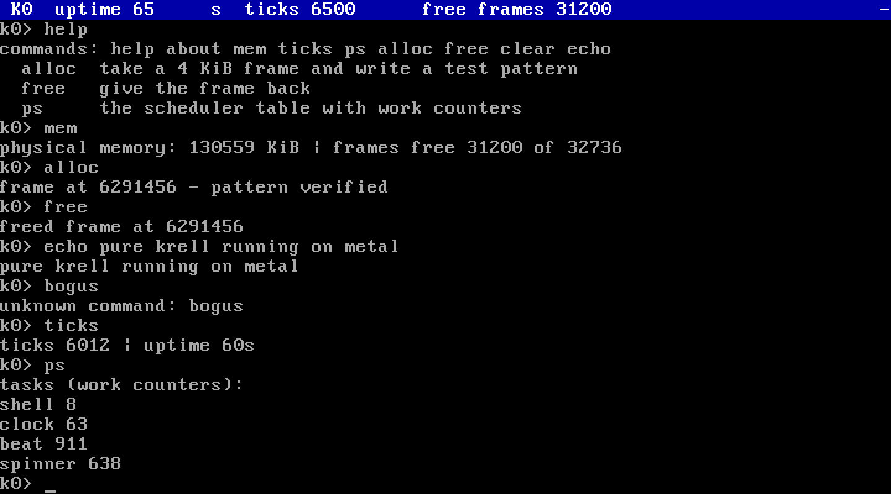

# K0 — a kernel in pure Krell

K0 is a small kernel whose logic is written entirely in
[Krell](https://github.com/nightwarelabz/krell), the machine-facing
portable assembly. Boot, console, serial, physical memory,
interrupt dispatch, the PIC and the PIT, the PS/2 keyboard, a
cooperative scheduler, a shell, a heap, a module runner, a
filesystem, a framebuffer console and a network driver — all of
it is one Krell module (`kernel.krell`, generated by
`kernel/gen_kernel.py` from eight template parts in `kernel/`), compiled by `krellc`
to native code and linked freestanding. The same module boots
on x86_64 and on aarch64 (QEMU `virt`); only the machine layer
differs.

## The machine layer

A kernel must touch the machine in ways a portable IR rightly
refuses to express. K0 keeps that surface as small as it can be:
`arch/x86_64/boot.s` (about 300 lines) holds the Multiboot header, the
32-to-64-bit transition, the interrupt entry trampoline, and
thirteen services the Krell code calls as externs:

| service | does |
|---|---|
| `k_out8(port, val)` / `k_in8(port)` | byte port I/O |
| `k_out16(port, val)` / `k_in16(port)` | word port I/O |
| `k_out32(port, val)` / `k_in32(port)` | dword port I/O |
| `k_lidt(ptr)` | load the interrupt table register |
| `k_sti` / `k_cli` / `k_hlt` | interrupt control |
| `k_stub_base` | address of the interrupt stub table |
| `k_arena_base` | address of the 1 MiB kernel state arena |
| `k_exec(ptr)` | call a native module entry, return its result |

On aarch64 the same thirteen services come from `arch/aarch64/boot_arm.s`:
page tables map virtual [0, 128 MiB) onto RAM at 0x40000000 so
the kernel's address space is identical; the PL011 UART serves
as COM1; the generic timer raises the tick at 100 Hz through
the GIC; UART input is translated to PS/2 set-1 scancodes; data
aborts from the VGA text range are emulated (stores dropped,
loads read zero) so the console code runs unchanged and all
output reaches the serial line. Boot state is fabricated as a
Multiboot information block, the same construction the x86_64
disk bootloader uses.

Everything above that line is Krell — including building the
256-entry IDT itself, entry by entry, in memory; remapping the
PIC; programming the PIT to 100 Hz; and dispatching every
interrupt through one Krell function, `k_dispatch`.

## What runs

- **Console**: VGA text with a live status bar (uptime, ticks,
  free frames, spinner), mirrored to COM1 at 115200. When a
  linear framebuffer is available the console renders as pixel
  text on it instead (see Display).
- **Physical memory**: a bitmap frame allocator built from the
  Multiboot memory map; the low 6 MiB is reserved for the image,
  tables and arena. `alloc` in the shell takes a frame and
  verifies a test pattern written through it; `free` returns it.
- **Heap**: `kmalloc`/`kfree` over a 1 MiB region taken from the
  frame allocator: first-fit with splitting, and coalescing on
  free. `heap` reports base, free bytes, live blocks and the
  largest free block; `htest` self-tests patterns, reuse of a
  freed block, and full coalescing.
- **Interrupts**: timer at 100 Hz, keyboard IRQ, exceptions
  print their vector and halt.
- **Scheduler**: cooperative tasks on tick periods — the status
  bar clock, a heartbeat, the spinner — beside the shell.
  `ps` shows each task's work counter.
- **Program layer**: Multiboot modules are loaded as a ramdisk
  (`mods` lists them; their frames are reserved in the physical
  allocator). A bytecode runner written in Krell decodes the
  canonical KREL format and interprets it in the kernel, so a
  module is a separate `.krel` file executed by `run <index>`
  with its own byte space and heap, against host services
  matched by extern name (`kprint`, `kputn`, `kputc`, `kticks`,
  `kalloc`, `kfree`). Vector and atomic instructions fault at
  load; module `fma` is evaluated as `fmul` then `fadd`. Three
  sample modules are in `modules/`.
- **Native modules**: the same module sources also compile
  ahead of time with the Krell x86_64 backend. `tools/natlink.py`
  links one at the fixed address 0x2000000, resolves its externs
  to the kernel's `nk*` service functions, and wraps the image
  in a 16-byte `K0N1` header (entry offset, file size, memory
  size). `nrun <index>` loads the image into the native region
  and calls its entry as machine code through `k_exec`; `run`
  and `nrun` each refuse the other's format.
- **Boot image**: `make boot.img` builds a disk image with its
  own two-stage bootloader (boot/stage1.s, boot/stage2.s, boot/mkboot.py):
  stage 1 loads stage 2 by LBA; stage 2 takes the E820 memory
  map, fabricates the Multiboot information block, loads the
  kernel and the modules by ATA PIO, and enters the kernel.
  The k0fs filesystem sits at LBA 8192 of the image; `fs_init`
  probes LBA 0 first (a standalone filesystem image) and then
  LBA 8192. K0 boots from this image with no Multiboot loader
  involved.
- **Storage**: an ATA PIO driver (primary bus, 28-bit LBA) and
  k0fs, a small filesystem: superblock at LBA 0, a directory of
  64-byte entries at LBA 1..64, file data bump-allocated from
  LBA 65. `dir` lists files, `cat` prints one, `store <name>
  <text>` writes one; files persist across boots on the disk
  image. `tools/mkdisk.py` formats an image with a seeded readme.
- **Display**: a framebuffer text console (8x16 bitmap font,
  generated from DejaVu Sans Mono) over a 1024x768 32 bpp
  linear framebuffer. QEMU's Multiboot loader does not act on
  the header video request, so the mode is set through the
  Bochs VBE interface of the standard VGA device (PCI class
  scan, BAR0 for the framebuffer address).
- **Network**: a polling driver for the Intel 82540EM (QEMU
  `e1000`): PCI configuration, MMIO register access, DMA
  descriptor rings, ARP and ICMP. The kernel answers ARP and
  ICMP echo requests for 10.0.2.15; the shell command `ping`
  resolves the gateway 10.0.2.2 by ARP and reports its ICMP
  echo reply.
- **TCP**: a single-connection TCP client (active open) over
  the same driver: `tcp <port> <text>` connects to the gateway
  (10.0.2.2), sends the text, prints the reply, and closes.
  There are no retransmit timers; a lost handshake segment
  fails the command.
- **Shell**: `help about mem ticks ps alloc free clear echo
  heap htest mods run nrun dir cat store ping tcp`.

## Test state



K0 booted in QEMU (qemu-system-x86, 128 MiB), driven by the
scripted session in drive.py (serial log: `serial.log`). The
session exercises the subsystems in order: `htest` passes
(patterns, reuse, coalescing); `run 0`, `run 1` and `run 2`
execute the sample modules (hello prints its lines and exits
with code 7; fib prints `fib(20) = 6765`; mem prints
`sum of 0..99 = 4950` and exits with code 3); `dir` and `cat`
read the k0fs image; a file written with `store` in one boot
is read back in a second boot on the same image
(tests/drive_storage.py); the framebuffer console renders the
session as pixel text at 1024x768 (tests/drive_display.py,
`screen-fb.png`); `ping` prints `reply from 10.0.2.2:
icmp_seq=1` under QEMU user networking (tests/drive_net.py);
`tcp 7777 hello over tcp` prints `reply:hello over tcp` from
a server on the host and `tcp: closed` (tests/drive_tcp.py); the
boot image boots from disk with no `-kernel` or `-initrd`,
runs a module, and reads back a file stored in the previous
boot (tests/drive_boot.py); the three sample modules compiled to
native code print and exit identically under `nrun`
(tests/drive_nat.py).

On aarch64 the same module boots on QEMU `virt` (proven on an
M1 Mac): the serial log shows the Multiboot handshake, 31,232
of 32,768 frames free, three ramdisk modules and the heap
ready; filesystem, framebuffer and network report none (absent
by design on this target); the scheduler is live, `run 1`
prints `fib(20) = 6765` with exit 0, and the timer advances
(124 ticks at about one second).

## Build and run

Needs the Krell toolchain from the v1.1 branch of the Krell
repository (`krellc`; see Notes) and QEMU.

```sh
make            # k0.32.elf, the bootable image
make run        # boot with modules, disk and network; shell on the terminal
make drive      # boot; scripted session (drive.py)
make disk.img   # format a fresh k0fs image (tools/mkdisk.py)
make boot.img   # disk image with the two-stage bootloader (boot/mkboot.py)
make nat        # compile the sample modules to native .nat images
make arm        # k0arm.elf, the aarch64 image (needs the ARM binutils)
make runarm     # boot k0arm.elf on QEMU virt; shell on the terminal
```

QEMU's Multiboot loader wants an ELF32 container, so the
64-bit image is wrapped with `objcopy -O elf32-i386`; the code
is entered in 32-bit mode exactly as Multiboot specifies, and
`arch/x86_64/boot.s` performs the long-mode transition.

The Krell module verifies for all three Krell targets
(x86_64, aarch64, riscv64); machine layers exist for x86_64
(`arch/x86_64/boot.s`) and aarch64 (`arch/aarch64/boot_arm.s`). Module identity (SHA-256
of the canonical binary encoding) is printed at build time by
`krellc parse`.

## Notes

- Toolchain: the kernel module has more than 256 functions,
  and the Krell v1 parser tables cap at 256 functions, so K0
  builds with the Krell v1.1 line, which raises the cap to
  1024. The v1.1 line also carries the surface parser fix for
  forward function references (a call to a later-defined
  function used to crash `krellc`; minimal reproduction:
  `forward-ref-repro.krell`). K0 sources are written in
  dependency order, which the generator preserves.
- No paging per process, no userspace, no preemption yet:
  K0 is a kernel core — scheduler, memory, interrupts and
  drivers under one address space.
